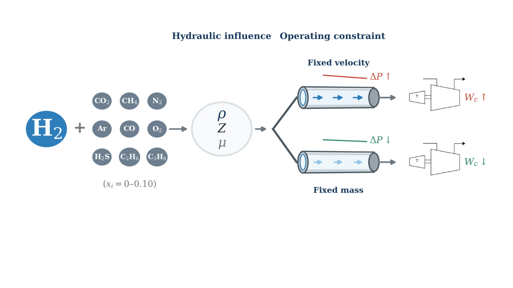

# Hydrogen Transport Research | MSc Advanced Chemical Engineering

**Abbas Rajaei** · University of Bradford, UK · MSc Advanced Chemical Engineering

This repository presents the two research components of my MSc work at the University of Bradford. The first study was published in a peer-reviewed journal. The second is presented as a complete research manuscript in PDF format. The first examines gas-hydrate phase equilibrium and was published in the *International Journal of Hydrogen Energy*. The second investigates how impurities change pipeline frictional requirements when the quantity of hydrogen delivered is held constant. Together, the studies address distinct flow-assurance and hydraulic questions in hydrogen pipeline transport.

## Research at a glance

| Study | Research question | Main methods | Research output |
|---|---|---|---|
| **1. Gas-hydrate phase equilibrium** | How do hydrogen concentration, impurity identity and pressure change hydrate stability? | Aspen HYSYS v14; HydraFlash; comparison with published experimental data | **Peer-reviewed article**, *International Journal of Hydrogen Energy* (2024) |
| **2. Hydrogen-pipeline hydraulics** | How do impurities change local frictional hydraulic-power requirements under different delivery constraints? | NIST REFPROP 9.0; Darcy–Weisbach hydraulics; Haaland friction factor; reduced-order regression | **Research manuscript** (not presented as a published article) |

## Study 1 — Influence of impurities in hydrate formation in H₂ pipelines

**Published article:** Abbas Rajaei and Nejat Rahmanian. *International Journal of Hydrogen Energy*, **94** (2024), 765–773.

**[Read the published article (DOI: 10.1016/j.ijhydene.2024.11.030)](https://doi.org/10.1016/j.ijhydene.2024.11.030)**

### Research objective

Gas hydrates can become stable at particular pressure–temperature–composition conditions and create a flow-assurance concern. This study predicted hydrate dissociation boundaries in hydrogen-rich gas systems over **2–15 MPa**. The binary systems included hydrogen with CH₄, C₂H₆, C₃H₈, CO₂ and H₂S; multicomponent hydrogen–hydrocarbon mixtures were also investigated.

### Thermodynamic methods

- **Aspen HYSYS v14:** Peng–Robinson equation of state with the Ng–Robinson hydrate model.
- **HydraFlash:** CPA-based fluid modelling, including SRK treatment for non-associating components, with van der Waals–Platteeuw hydrate theory.
- **Model evaluation:** predicted pressure–temperature phase boundaries were compared with published experimental hydrate-equilibrium measurements.

### Findings

Within the investigated systems, H₂S produced the strongest predicted shift of hydrate stability towards higher temperatures. C₃H₈ and C₂H₆ also raised predicted hydrate-formation temperatures. The hydrogen concentration affected predicted hydrate regions, including the relationship between structure-I and structure-II hydrate boundaries. Model agreement with experimental measurements depended on mixture composition and pressure: HYSYS performed better for several of the assessed datasets, whereas HydraFlash performed better in certain intervals. The findings should be interpreted within the mixtures and data ranges examined in the article.

## Study 2 — Impurity effects on hydrogen-pipeline hydraulics

**[Read the complete manuscript (PDF)](manuscript/Impurity_Effects_on_Hydrogen_Pipeline_Hydraulics.pdf)**

### Research objective and scope

A comparison based only on fixed gas flow can conceal the effect of impurity dilution on delivered hydrogen. The study therefore evaluated how impurity concentration changes thermophysical properties, local frictional pressure gradient and local frictional hydraulic-power requirement under three separate operating constraints:

1. Fixed bulk velocity.
2. Fixed **total mixture** mass flow.
3. Equivalent **hydrogen** mass delivery.

The numerical calculations cover **2,160 impurity-containing states** across nine binary hydrogen–impurity systems: CH₄, CO₂, Ar, CO, C₂H₆, H₂S, N₂, C₃H₈ and O₂. The composition range is **1–10 mol% impurity**, with temperatures of **0–40 °C** and absolute pressures of **20–250 bar**. Each mixture state was compared with pure hydrogen at the same pressure and temperature.

### Graphical abstract



*The supplied schematic illustrates the fixed-velocity and fixed-total-mass-flow cases. The third case, equivalent hydrogen mass delivery, is treated in the manuscript but is not shown in the graphic. The schematic's compressor symbols are conceptual; compressor shaft power was not modelled.*

### Numerical hydraulic framework

Thermophysical properties were calculated in **NIST REFPROP 9.0** and propagated through local, steady, single-phase pipeline hydraulic equations. Density (ρ), dynamic viscosity (μ) and compressibility factor (Z) were used to evaluate the Reynolds number and the Darcy friction factor through the **Haaland** correlation. The local frictional pressure gradient was obtained from **Darcy–Weisbach**:

$$
G = -\left(\frac{\mathrm{d}P}{\mathrm{d}L}\right)_f = \frac{f\rho v^2}{2D}.
$$

The associated local frictional hydraulic-power requirement per unit length was defined as

$$
\mathcal{P}_{\mathrm{hyd}} = QG\qquad [\mathrm{W\,m^{-1}}].
$$

This is **not** a full-pipeline pressure-drop simulation or a prediction of compressor shaft power. The common comparison geometry was a 1.2 m internal diameter, 46 μm roughness and a 10 m/s pure-hydrogen reference velocity. Longitudinal changes in properties and compressor thermodynamics were outside the model scope.

### Reduced-order mathematical models

To avoid repeating the full REFPROP-to-hydraulics calculation for every screening case, two impurity-specific models were fitted to the **normalised local frictional hydraulic-power ratio under equivalent hydrogen delivery**.

**Model A — State-resolved correlation.** A seven-coefficient function of impurity concentration, pressure and temperature, including quadratic and interaction terms:

$$
\widehat{\Pi}_i = 1 + \chi \left(a_i+b_i\chi+c_ip+d_i\theta+e_ip^2+f_i\theta^2+g_ip\theta\right),
$$

where χ, p and θ are scaled concentration, pressure and temperature variables. Coefficients were fitted using ordinary least squares. Grouped cross-validation withheld all ten non-zero concentrations at one pressure–temperature pair per fold; it therefore measures approximation across the *sampled* operating grid, not extrapolation outside that grid.

**Model B — Cubic screening correlation.** A cubic fit to the maximum calculated power ratio among the 24 sampled pressure–temperature states at each concentration:

$$
\widehat{\Pi}_{i,\max} = 1+\alpha_i\chi+\beta_i\chi^2+\gamma_i\chi^3.
$$

The fitted curves were inverted to estimate concentrations associated with nominal **25%, 50% and 100% increases** in the local frictional hydraulic-power requirement. These estimates are *screening approximations*, not guaranteed continuous-domain limits or hydrogen-quality specifications.

### Main results

| Finding | Reported result |
|---|---|
| Fixed total mixture mass flow | Lower local frictional requirement, but reduced delivered hydrogen throughput |
| Equivalent hydrogen mass delivery | Higher local frictional hydraulic-power requirement at every sampled impurity-containing state |
| At 10 mol% impurity, equivalent delivery | **2.227–4.056×** the matched pure-hydrogen local frictional hydraulic-power requirement |
| State-resolved model: pooled grouped-CV relative RMSE | **0.44%** |
| State-resolved model: maximum absolute grouped-CV relative error | **1.86%** |
| Fitted concentration for nominal +25% hydraulic requirement | **C₃H₈: 1.03 mol%; CO₂: 1.04 mol%; CH₄: 2.39 mol%** |

Density increased almost linearly with impurity concentration within the investigated range, while viscosity had stronger nonlinear dependence. The relative effect of CO₂ and C₃H₈ could change with operating state. These findings support comparing individual impurities at matched conditions and at the same **hydrogen mass delivered**.


## Repository contents

```text
msc-hydrogen-transport-research/
├── README.md
├── assets/
│   └── graphical-abstract.png
└── manuscript/
    └── Impurity_Effects_on_Hydrogen_Pipeline_Hydraulics.pdf
```

The published study is linked to its journal DOI rather than redistributing the publisher's PDF. No software source code, REFPROP files or supplementary numerical workbooks are included in this repository.

